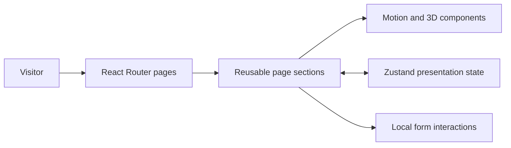

<div align="center">

# MetaQube

### An interactive brand experience for a technology studio

3D visuals, motion-led storytelling, and a modular React interface.


[Visit the website](https://ai-web3-blockchain.netlify.app/) · [Developer portfolio](https://www.builtbyvansh.com/) · [Discuss a frontend project](mailto:founder@builtbyvansh.com)

</div>

---

MetaQube is a frontend showcase for presenting technology services through an expressive visual identity. It combines a Three.js hero, animated sections, interactive service selection, maps, and a multi-page content structure.

**Scope of this repository:** a React/Vite marketing website. Although the site discusses AI, Web3, and metaverse services, this checkout does not implement wallet authentication, blockchain transactions, an AI chat backend, or persisted customer accounts.

## What to explore

| Experience | Implementation focus |
| --- | --- |
| **3D hero** | Three.js through React Three Fiber and Drei, integrated into the page composition. |
| **Motion and visual identity** | Framer Motion transitions, cursor effects, typography, and custom Tailwind colors. |
| **Service discovery** | Reusable service sections, dialogs, and a configurable “Build Your Qube” interaction. |
| **Maps and community presentation** | Partner/community map components and local display data. |
| **Multi-page site** | Home, About, Services, Case Studies, Careers, Blog, Contact, Privacy, and Terms routes. |
| **Shared state** | Zustand state for presentation modes, options, and easter-egg interactions. |

This project is most useful as evidence of **React composition, interactive frontend work, animation, and brand implementation**.

## Structure and data flow



```text
src/
  App.tsx                  Routing and global presentation effects
  pages/                   Site pages and content
  components/
    3d/                    Hero scene
    layout/                Shared navigation
    sections/              Hero, services, maps, builder and footer
    ui/                    Dialogs, toggles and reusable controls
  store/useAppStore.ts      Presentation and selection state
  hooks/                   Pointer and device-orientation helpers
  types/                   Shared interface types
public/                    Logos and static assets
```

**Stack:** React 18, TypeScript, Vite 5, Tailwind CSS 3, React Router 6, Framer Motion, Three.js, React Three Fiber/Drei, Zustand, and Radix UI.

## Run locally

Use Node.js/npm compatible with the lockfile. The locked Vite package declares Node.js **18+ or 20+**.

```bash
git clone https://github.com/VanshMehta1234/MetaQube.git
cd MetaQube
npm ci
npm run dev
```

Open the local URL printed by Vite, normally [localhost:5173](http://localhost:5173).

No application environment variables or backend service are required by the current source. Some imagery is loaded from external URLs, so those assets need network access.

## Customization and handover

| To change… | Start here |
| --- | --- |
| Brand colors and styling | `tailwind.config.js`, `src/index.css` |
| 3D hero | `src/components/3d/HeroCube.tsx` |
| Services and project selection | `src/components/sections/`, `src/store/useAppStore.ts` |
| Content and route composition | `src/pages/`, `src/App.tsx` |
| Inquiry/scheduling integration | `ContactPage.tsx`, `ScheduleCallDialog.tsx`, `BuildYourQube.tsx` |

### Current integration boundaries

- **Forms are interface demonstrations.** Scheduling and builder submissions update local UI state; they are not connected to a booking service, CRM, email sender, or database. Connect and verify the intended delivery service before using them for real inquiries.
- **Content is local.** Blog entries include sample content; there is no CMS integration in this repository.
- **MetaMirror needs a store action.** The toggle component references `toggleMetaMirrorMode`, but the current `useAppStore.ts` does not expose that action. Wire the action before relying on the toggle as a working interaction.
- **Build and type checking are separate.** `npm run build` runs Vite only; it is not evidence that TypeScript and every runtime interaction have passed validation.

These boundaries keep the frontend demonstration distinct from services that would need to be added for a commercial rollout.

## Commands and deployment

| Command | Purpose |
| --- | --- |
| `npm run dev` | Start Vite locally. |
| `npm run lint` | Run the configured ESLint checks. |
| `npm run build` | Create the static `dist/` output. |
| `npm run preview` | Preview a built site locally. |

For static hosting, build with `npm run build`, publish `dist/`, and configure a fallback to `index.html` for React Router URLs. Verify direct navigation to `/about`, `/services`, and `/contact`, alongside the homepage.

Before handover, review mobile navigation, keyboard interaction in dialogs, form integration, the MetaMirror action, and 3D behavior on the target devices. No automated test script is included in the current package.

---

Built by **Vansh Mehta** · [Portfolio](https://www.builtbyvansh.com/) · [Email](mailto:founder@builtbyvansh.com)
